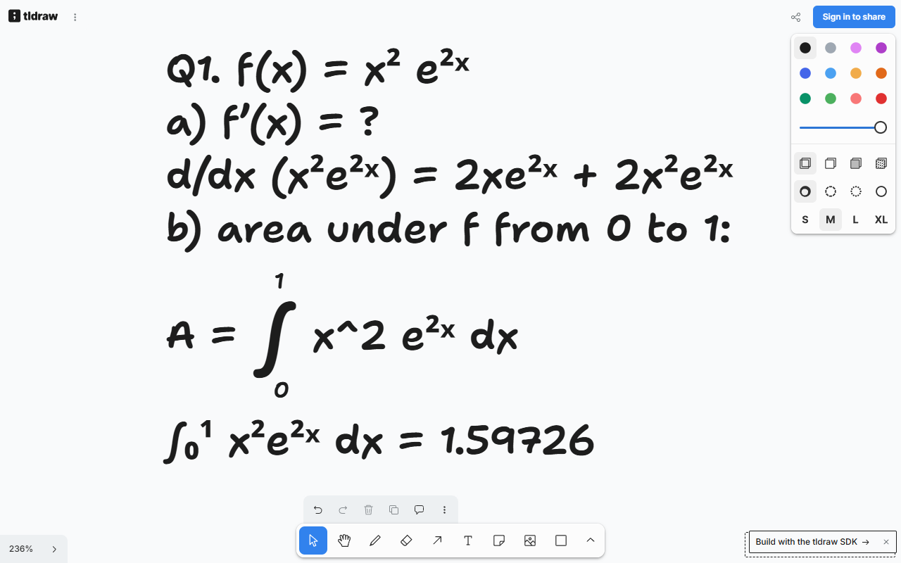
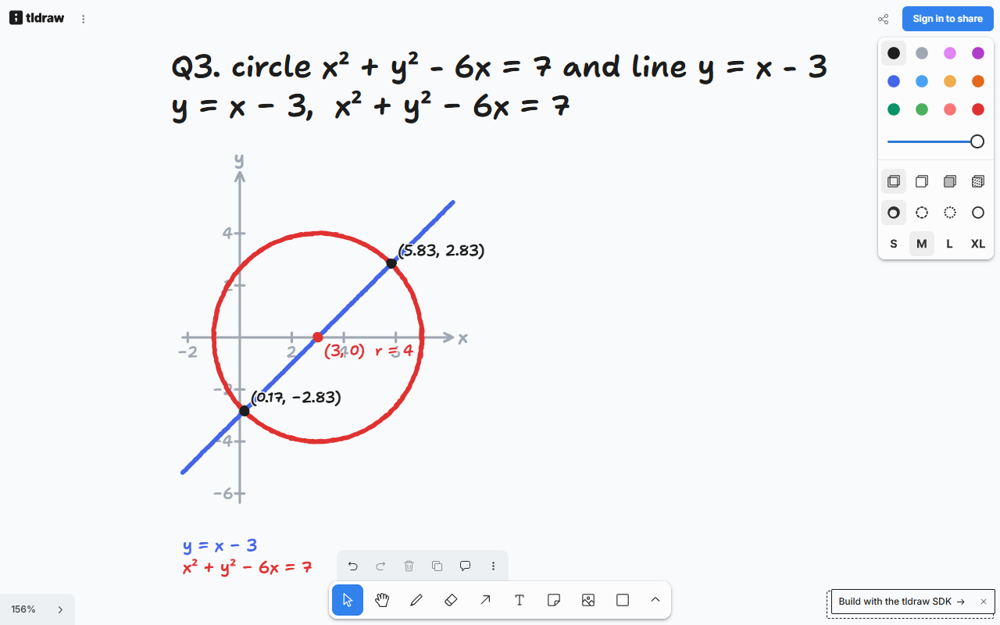
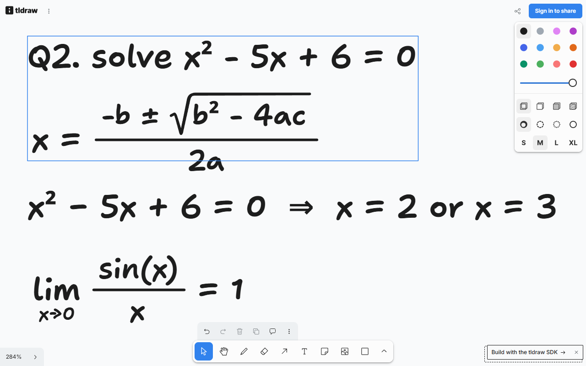
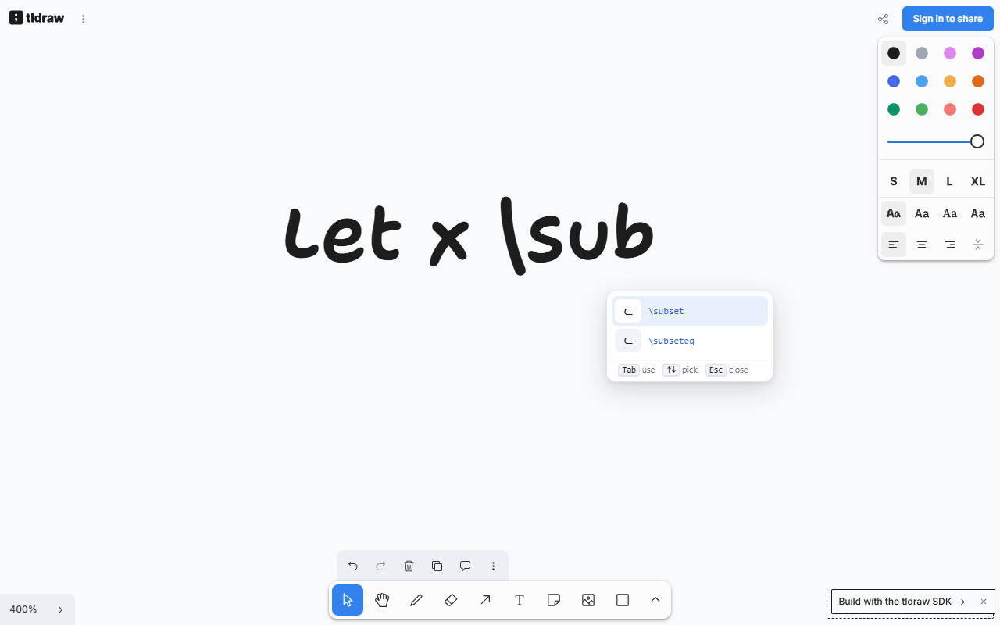
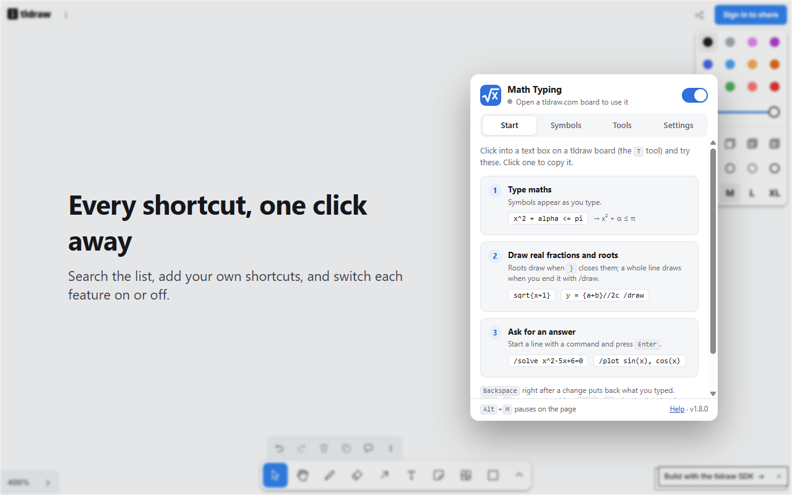

# Math Typing for tldraw

Write maths on [tldraw.com](https://tldraw.com) the way you'd write it on paper. A browser extension for
**Firefox, Zen, Chrome and Edge**. Not made by or affiliated with tldraw.



## What it does
- **Symbols as you type**: `x^2` → x², `alpha` → α, `\in` → ∈, `->` → →, `+-` → ±, `RR` → ℝ, and about 120 more.
- **Real roots, fractions and bounds**, drawn as tldraw shapes: `sqrt{x+1}` (the bar grows as you type),
  `d/dx`, `lim_{x->inf}`, `int_{0}^{1}`.
- **Whole equations**: a line with `//` fractions is laid out when you press Enter (or end it with `/draw`),
  with nested fractions, bounds, raised exponents and roots.
- **Calculator**: `/calc`, `/diff`, `/integrate`, `/solve`, `/simplify`, `/factor`, `/expand` + Enter.
  Answers are checked numerically before they're written.
- **Graphs**: `/plot sin(x), cos(x)` or `/plot f(x)=x^2, g(x)=2x` draws a graph with crossing points and
  circle centres marked. `y = 3x^2 + 2x /draw` graphs it too.
- **Shapes**: `/draw triangle AB=3 BC=4 AC=5`, `/draw circle 3` … with sides and angles marked.
- **Writing flow**: Enter after a drawing or an answer continues on the next line at the left edge;
  Backspace right after a change puts back what you typed; Alt+M pauses everything.
- **Matching fonts**: symbols tldraw's fonts lack come from bundled fonts that match its styles.
- **A popup** with a quick start, every shortcut (searchable), your own shortcuts and a switch per feature.

| | |
|---|---|
|  |  |
|  |  |

## Install
From the stores (once published): Firefox Add-ons (also for Zen) · Chrome Web Store (also for Edge).

From a release or a build:
- **Zen / Firefox**: open `math-typing-firefox-<version>.xpi` and click **Add**. Unsigned builds need
  `xpinstall.signatures.required = false` in `about:config` (Zen and Firefox Developer Edition allow this).
- **Chrome / Edge**: `chrome://extensions` → Developer mode → **Load unpacked** → `dist/chrome`.

## Cheat sheet
### Typing
| Type | Get |
|---|---|
| `x^2`, `x^-12`, `e^{2x}`, `x^(n+1)` | x², x⁻¹², e²ˣ, xⁿ⁺¹ |
| `x_1`, `x_max`, `a_{n-1}` | x₁, xₘₐₓ, aₙ₋₁ (not inside words like `my_name`) |
| `sqrt{x+1}`, `cbrt{8}` / `sqrt(81+9)` | a drawn root / √(81+9) inline |
| `2*3`, `2**3`, `8 div 2` | 2×3, 2·3, 8 ÷ 2 (`* item` lists and `**bold**` stay as typed) |
| `+-` `-+` `>=` `<=` `!=` `~=` `===` | ± ∓ ≥ ≤ ≠ ≈ ≡ |
| `->` `=>` `<->` `<=>` `...` | → ⇒ ↔ ⇔ … |
| `abs{x}`, `vec{v}`, `bar{x}`, `hat{x}` | \|x\|, v⃗, x̄, x̂ |
| `pi` `inf` `90deg` `approx` `forall` `emptyset` | π ∞ 90° ≈ ∀ ∅ |
| `alpha` … `omega`, `Delta` `Sigma` `Omega` | α … ω, Δ Σ Ω |
| `NN` `ZZ` `QQ` `RR` | ℕ ℤ ℚ ℝ |
| `\in` `\subseteq` `\cup` `\sum` `\exists` `\therefore` `\angle` `\perp` … | ∈ ⊆ ∪ ∑ ∃ ∴ ∠ ⊥ … |

### Drawing
| Write | Drawn as |
|---|---|
| `y = x//{x+3} + 4` + Enter | x over x+3, + 4 (`{…}` groups a part; `\\` works like `//`) |
| `x = {-b +- sqrt{b^2-4ac}}//{2a}` + Enter | the quadratic formula |
| `lim_{x->0} sin(x)//x = 1` + Enter | lim with x→0 below, sin(x) over x |
| `int_0^1 x^2 dx = 1//3 /draw` | ∫ with 0 below and 1 above |
| `d/dx` + space, `dy/dx`, `∂/∂x` | stacked |

### Commands (start the line with `/`, press Enter)
| Line | Result |
|---|---|
| `/calc 2^10/3`, `/calc sin(30°)` | `2¹⁰/3 = 1024/3 ≈ 341.333`, `0.5` |
| `/diff x^3 sin(x)` | `d/dx (x³·sin(x)) = 3x²·sin(x) + x³·cos(x)` |
| `/integrate x^2 from 0 to 3` | `∫₀³ x² dx = 9` |
| `/solve x^2-5x+6=0` | `x = 2 or x = 3` |
| `/factor`, `/expand`, `/simplify` | `(x − 2)·(x − 3)` … |
| `/plot sin(x), cos(x)`, `/plot x^2+y^2=25, y=x` | a graph, crossings and centres marked |
| `/draw triangle AB=3 BC=4 AC=5`, `circle 3`, `hexagon 2`, `angle 40` | the shape with sides and angles |

Lines without the slash are never run.

## Privacy
Math Typing collects nothing and sends nothing anywhere. It runs only on tldraw.com and keeps its settings
in the browser's extension storage. See [store/privacy.md](store/privacy.md).

## Development
```sh
npm install
npm test               # unit tests (typing rules, calculator, figures)
npm run build          # dist/firefox, dist/chrome and their zips
npm run lint           # Mozilla's add-on linter on the Firefox build
npm run e2e:chrome     # Chromium + the Chrome build on tldraw.com (CHROME_PATH optional)
npm run e2e:zen        # Zen/Firefox + the Firefox build (ZEN_PATH, GECKODRIVER)
npm run screenshots    # store screenshots and the promo tile
```
See [CONTRIBUTING.md](CONTRIBUTING.md) for how it fits together and how releases are made.

## Credits
Started by [Boaz Cohen](https://github.com/BoazCohenJ) and [Yotam Moshe](https://github.com/yotam1001).
Symbolic maths by [nerdamer](https://github.com/jiggzson/nerdamer); fonts by the Noto and DejaVu projects
(see [THIRD_PARTY_NOTICES.md](THIRD_PARTY_NOTICES.md)).

## License
To be decided by the authors before the first store release.
